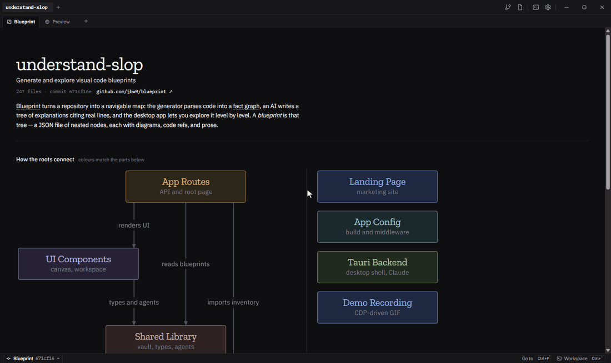

# blueprint

A visual blueprint of a codebase. Start with the product's features, then go deeper, down to the line of code.



## Why

Code gets written faster than anyone can read it. Asking an assistant "how does this work?" answers one question but loses the big picture. blueprint lets you explore instead.

## Install

On macOS, Linux, or Windows (in Git Bash):

```bash
curl -fsSL https://blpr.dev/install.sh | sh
```

It downloads the latest build for your system, or builds from source where there is none. Run it again to update. What it needs and doesn't find, it installs: its own Node 22 in `~/.blueprint/node` when yours is missing or older, Apple's command line tools, Linux's system libraries (asking for your password), and Claude Code.

- `BLUEPRINT_FROM_SOURCE=1` builds from source anyway (kept in `~/.blueprint/src`; `BLUEPRINT_DIR` moves it)
- `BLUEPRINT_NO_TELEMETRY=1` skips the two pings it sends as it starts and ends: your OS, the step it reached, why it stopped (with your home folder's path taken out), what it installed for you, and an id the app reuses when it says it opened. The app's Settings → Privacy turns its own reports off.

## Layout

- `app/` - the app: the Next.js UI and its local API (`app/`, `components/`, `lib/`), the desktop shell (`src-tauri/`), and the blueprint generator (`scripts/generate/`)
- `landing/` - the landing page at blpr.dev (`npm run dev`, port 3001)
- `admin/` - the admin dashboard at blpr.dev/admin: one static page; its data lives behind `app/scripts/api`
- `scripts/build-site.sh` - builds blpr.dev (landing, demo blueprints, admin) for the deploy workflow
- `install.sh` - the one-line install
- `docs/` - design notes and the decision log
- `demo/` - the README's GIF; `node demo/record.mjs` records it again from the installed app (Windows, needs ffmpeg)
